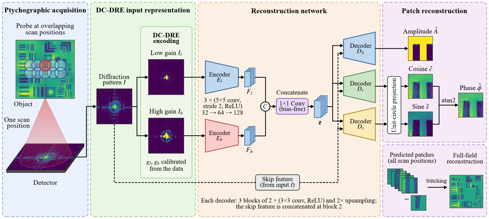
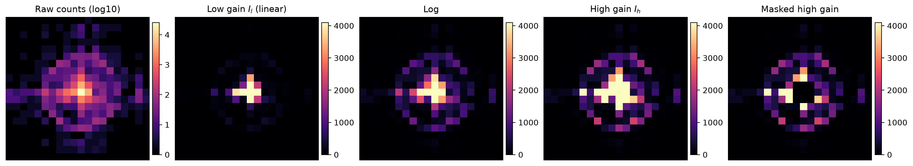

# Diffraction-Calibrated Dual-Range Input Representation for Neural Ptychographic Image Reconstruction

<p align="center">
  
</p>

Official PyTorch implementation of **Dynamic-range-aware input representation
for deep ptychographic reconstruction**, with support for simulated AD_LTEM and
experimental X-ray ptychography data.

Carson Yu Liu, Jun Cheng, Chien-Chun Chen, and Steve F. Shu

Ptychographic diffraction patterns span orders of magnitude: a small central
disc holds most of the counts, while the weak high-angle signal that encodes
fine structure lies near the noise floor. The network receives the measured
intensities through Diffraction-Calibrated Dual-Range Encoding (DC-DRE), a
data-calibrated pair of low- and high-gain views, predicts the phase as a point
on the unit circle, and can be trained with any of the input representations
compared in the paper.

## Quick start

```bash
git clone https://github.com/carson-liu/dc-dre-ptychography.git
cd dc-dre-ptychography

python -m venv .venv
source .venv/bin/activate
pip install -r requirements.txt

python main.py --mode generate
python main.py
```

The final command evaluates the included pretrained AD_LTEM checkpoint at
`checkpoints/ad_ltem/model.pth` and saves figures to `results/ad_ltem/`.

## Demo

After generating the AD_LTEM data, launch the pretrained notebook demo with:

```bash
jupyter notebook demo.ipynb
```

The demo shows the input representations of a diffraction pattern, patch
reconstructions, and the stitched 12 x 12 test region.

<p align="center">
  
</p>

## Data sources

### AD_LTEM simulation

The simulated dataset is based on the modified 1951 USAF resolution chart from
[AD_LTEM](https://github.com/danielzt12/AD_LTEM). The source images and probe
used by this repository are included under `simulation/assets/`.

Generate the arrays used in the paper:

```bash
python main.py --mode generate --seed 0
```

The simulation uses a `512 x 512` object (amplitude in [0.5, 1], phase range
0.8 rad), a `32 x 32` probe, and 75% probe overlap (61 x 61 scan positions).
It writes:

```text
75_amp.npy                  object amplitude patches
75_ph.npy                   object phase patches (rad)
75_diff_noise_free.npy      noise-free diffraction intensities
75_diff.npy                 noisy intensities: Gaussian (sigma 0.01) plus Poisson noise
```

The amplitude, phase, and noise-free patterns are identical to those used in
the paper. The seed fixes the noise realization, which differs from the one in
the paper; pretrained models therefore score within a few tenths of an SSIM
point of the paper's values on the noisy test set.

### Experimental X-ray data

The experimental dataset is the tungsten-pattern dataset from
[PtychoNN](https://github.com/mcherukara/PtychoNN), acquired at the Advanced
Photon Source sector 26. The official files are hosted in the
[PtychoNN_data dataset](https://huggingface.co/datasets/mcherukara/PtychoNN_data/tree/main).

Download the two required files into the repository root:

```bash
curl -L "https://huggingface.co/datasets/mcherukara/PtychoNN_data/resolve/main/20191008_39_diff_reduced.npz?download=true" \
  -o 20191008_39_diff_reduced.npz
curl -L "https://huggingface.co/datasets/mcherukara/PtychoNN_data/resolve/main/20191008_39_amp_pha_10nm_full.npy?download=true" \
  -o 20191008_39_amp_pha_10nm_full.npy
```

Experimental diffraction, amplitude, and phase are used in their original
values. The test set is the block of the last 60 scan rows and first 60
columns; each `64 x 64` reconstruction contributes its central `18 x 18`
region with a three-pixel scan step, overlapping values are averaged, borders
are cropped, and the result is resized to `60 x 60`.

## Training and testing

Pretrained checkpoints are included for all three datasets:

```bash
python main.py --dataset ad_ltem --mode test
python main.py --dataset ad_ltem_noise_free --mode test
python main.py --dataset experimental --mode test
```

Train the final model (DC-DRE input):

```bash
python main.py --dataset ad_ltem --mode train --seed 0
python main.py --dataset ad_ltem_noise_free --mode train --seed 0
python main.py --dataset experimental --mode train --seed 0
```

Train the same network with a different input representation:

```bash
python main.py --mode train --representation raw
python main.py --mode train --representation diff_max
python main.py --mode train --representation linear
python main.py --mode train --representation high_only
python main.py --mode train --representation sqrt
python main.py --mode train --representation log
python main.py --mode train --representation masked
python main.py --mode train --representation dc_dre --stack-views
```

Training runs for 40 epochs on AD_LTEM and 25 epochs on the experimental data
(Adam, learning rate 1e-3 with a triangular-2 cyclic schedule between 1e-4 and
1e-3, batch size 64, gradient clipping at 1) and keeps the model after the last
epoch. Checkpoints are saved to `runs/<dataset>/<representation>/seed_<seed>/`,
and the test metrics are printed at the end of training. Several checkpoints
are averaged in test mode:

```bash
python main.py --mode test --checkpoint runs/ad_ltem/log/seed_*/model.pth
```

The paper reports the mean over seeds 0 to 4. Runs with the same seed are not
bit-identical because some GPU kernels are non-deterministic; single runs can
differ by about one SSIM point. Reduced-overlap experiments were generated by
varying the simulated scan step while keeping the reconstruction pipeline
unchanged.

## Evaluation

`utils/metrics.py` is the only evaluation code. On AD_LTEM data, labels and
predictions are min-max normalised with the dataset range; per-patch SSIM and
PSNR use the range of the test labels, and the stitched metrics use the range
of the stitched ground truth (adaptive weighted stitching,
`utils/stitching.py`). On experimental data, the physical amplitude and phase
are stitched and evaluated with the range of the stitched ground truth. The
predicted phase $\mathrm{atan2}(\tilde s,\tilde c)$ is placed in the $2\pi$
interval centred on the label phase range.

## Repository structure

```text
.
├── main.py                       # train, test, or generate data
├── demo.ipynb                    # pretrained AD_LTEM demo
├── checkpoints/
│   ├── ad_ltem/                  # included pretrained checkpoints
│   ├── ad_ltem_noise_free/
│   └── experimental/
├── assets/                       # figures
├── datasets/
│   ├── ad_ltem.py                # AD_LTEM data and split
│   └── experimental.py           # experimental data and split
├── models/
│   ├── network.py                # encoders, fusion, skip path, decoders
│   ├── representations.py        # input representations and calibration
│   └── loss.py                   # MSE + gradient + SSIM objective
├── simulation/
│   ├── assets/                   # amplitude, phase, and probe
│   └── ptychography.py           # forward simulation
├── utils/
│   ├── inference.py
│   ├── metrics.py                # canonical evaluation
│   ├── stitching.py              # dataset-specific stitching
│   ├── training.py
│   └── visualization.py
└── requirements.txt
```

## Citation

Citation information will be added after publication.

## License

MIT License. See [LICENSE](LICENSE).
